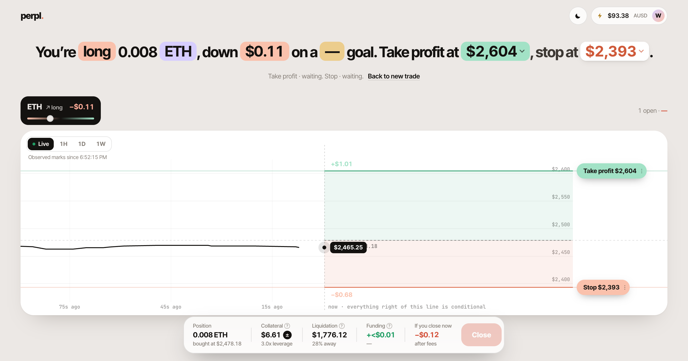
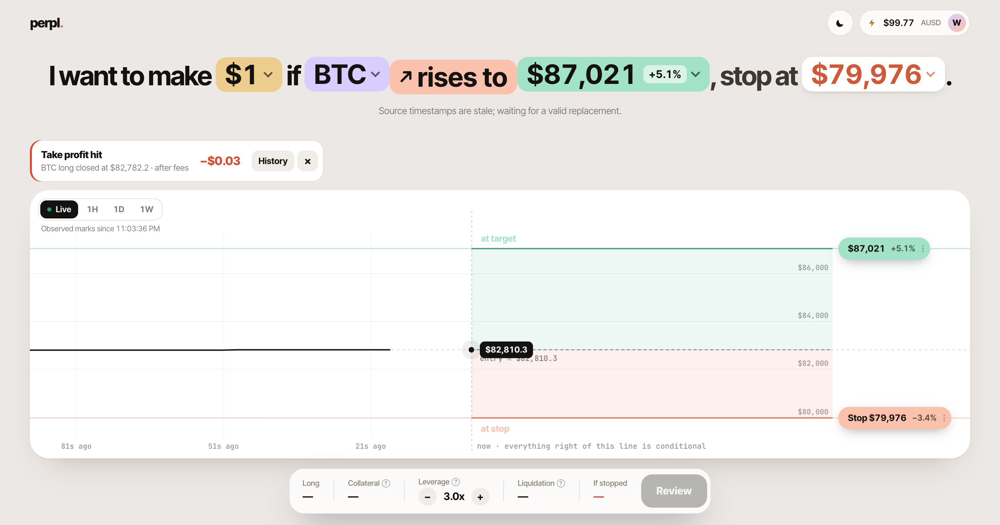
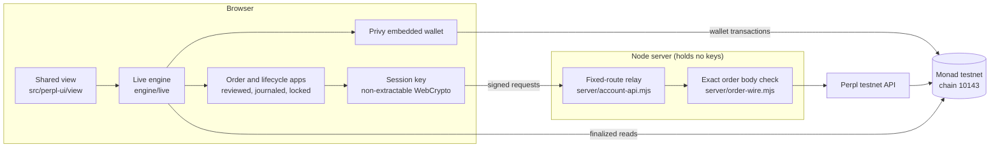

<div align="center">

<picture>
  <source media="(prefers-color-scheme: dark)" srcset="brand/mark-my-words-logo-night.svg">
  
</picture>

### Say the trade. Place the trade.

Write your call as one sentence and Mark My Words opens it as a real perp on **Monad testnet** through Perpl, through an interface anyone can use.

[](https://testnet.monadexplorer.com)
[](https://testnet.perpl.xyz)
[](https://privy.io)
[](https://react.dev)
[](tsconfig.json)
[](LICENSE)

[Demo video](https://www.youtube.com/watch?v=YoIrEk600Bg) · [Pitch video](https://www.youtube.com/watch?v=BAn_P6IdQqY) · [Try it](#for-judges-try-it-in-10-minutes) · [How it works](#how-a-sentence-becomes-a-trade) · [Onchain proof](#onchain-proof) · [Run locally](#run-it-locally) · [Architecture](#architecture) · [Roadmap](#roadmap)

<br>



<sub>A real ETH long on Monad testnet, opened by a brand-new email user. The take profit and stop are live orders on Perpl.</sub>

</div>

> **I want to make $1 if ETH rises to $2,620, stop at $2,400.**
>
> You type that, and Mark My Words sizes the position from the live Perpl order book, shows the cost, collateral and liquidation price, then opens it. The stop loss and take profit go on Perpl as real orders right after the fill.

## Who it's for

Plenty of people have a take on where ETH is heading. Very few of them have ever opened a perp, usually because the first screen asks for size, margin mode, leverage and trigger types before they can say what they think will happen. I built Mark My Words to make trading something an everyday person can understand, and actually enjoy.

My first user is the person who already posts price calls in a group chat or on X and has never placed a perp. Perps venues build terminals for professionals, starting from size and leverage, and the simpler apps I've seen tend to hide the risk. I haven't found one that starts from the trader's own words and makes the stop mandatory.

Over Oct 12 and 13 my 2 test accounts logged 27 successful onchain transactions. That covers ETH and BTC, longs and shorts, partial and full closes, two positions open at once, a BTC long at 15x (Perpl's maximum), and a take profit and a stop loss that Perpl fired on its own. Selected transactions are under [Onchain proof](#onchain-proof).

## What works on testnet

> [!IMPORTANT]
> The default route `/` runs against **Monad testnet (chain 10143)** and **Perpl's testnet exchange**. Selected transactions are listed under [Onchain proof](#onchain-proof).

| Feature          | What you do                                                     | What happens                                                                                                                 |
| ---------------- | --------------------------------------------------------------- | ---------------------------------------------------------------------------------------------------------------------------- |
| Sentence trading | Set profit goal, market, direction, target and stop in one line | The app sizes it across live Perpl book levels and shows fees, collateral and liquidation before you confirm                 |
| Login            | Sign in with email through Privy                                | After email login, one tap creates an embedded wallet. You don't need an extension or seed phrase                            |
| Funding          | Claim from the faucet, approve, deposit, withdraw               | Each step is a wallet transaction you review, checked against its receipt                                                    |
| One-tap session  | Sign once for 24 hours                                          | A trade-only Perpl API key, held by a browser key that page scripts can't read. It cannot withdraw                           |
| Markets          | Trade ETH or BTC, long or short                                 | Two positions can be open at once, from 1x up to Perpl's maximum (ETH 12x, BTC 15x)                                          |
| Protection       | Set a stop on every entry                                       | Stop and take profit go on Perpl as trigger orders right after the fill                                                      |
| Management       | Drag a chip, close part, close all                              | Exits are amended in place, closes are reduce-only, and results come from Perpl's signed history                             |
| Honest numbers   | Read what's on screen                                           | A sent order shows as filled only after the fill is confirmed. A value the app can't verify shows as unavailable, never as 0 |

`/?mode=demo` runs a separate demo of the same interface on fixture data. It never touches a chain.

## How a sentence becomes a trade


## Onchain proof

Everything here is on testnet. Explorer: [testnet.monadexplorer.com](https://testnet.monadexplorer.com).

We use Perpl's and Monad's existing contracts and deployed none of our own:

| Contract         | Address                                                                                                                              |
| ---------------- | ------------------------------------------------------------------------------------------------------------------------------------ |
| Perpl exchange   | [`0x1964C32f0bE608E7D29302AFF5E61268E72080cc`](https://testnet.monadexplorer.com/address/0x1964C32f0bE608E7D29302AFF5E61268E72080cc) |
| AUSD collateral  | [`0xa9012a055bd4e0eDfF8Ce09f960291C09D5322dC`](https://testnet.monadexplorer.com/address/0xa9012a055bd4e0eDfF8Ce09f960291C09D5322dC) |
| Test AUSD faucet | [`0xd236c18D274E54FAccC3dd9DDA4b27965a73ee6C`](https://testnet.monadexplorer.com/address/0xd236c18D274E54FAccC3dd9DDA4b27965a73ee6C) |

Selected transactions from a fresh email user's account, Oct 12 to 13, 2026:

| Step                                                 | Market       | Transaction                                                                                                              |
| ---------------------------------------------------- | ------------ | ------------------------------------------------------------------------------------------------------------------------ |
| Claim test AUSD                                      | wallet       | [`0xe3ec…70f3`](https://testnet.monadexplorer.com/tx/0xe3eca08b1a3bad2b83e3a699ea9344a361a159acfe3875d288c903ef218870f3) |
| Create Perpl account and deposit 100 AUSD            | account 1168 | [`0x3b7d…37e8`](https://testnet.monadexplorer.com/tx/0x3b7df65f0c11652431070d26c36e8588d2fe465b7c5be5f49455a00bca4c37e8) |
| Open long from a sentence, 3x                        | ETH          | [`0x514f…41e1`](https://testnet.monadexplorer.com/tx/0x514f6e4f91ca74598d05e1b1c8f76b9765dda67b4cf0b14ff0704cb9835241e1) |
| Full reduce-only close                               | ETH          | [`0x8286…97bf`](https://testnet.monadexplorer.com/tx/0x828675f1d539083ddae200c95fd4e96ae50bcd96876ceed75642bf79c0f497bf) |
| Partial close 50%                                    | ETH          | [`0x067b…cabf`](https://testnet.monadexplorer.com/tx/0x067b217cae0ae7f33b04fe4aeccc9a4d54749c7255ab38106906254567e4cabf) |
| Open short                                           | ETH          | [`0x354a…3f30`](https://testnet.monadexplorer.com/tx/0x354ad06757d2eba0594c4f17e586121152c37bf94778bd602eea24df783e3f30) |
| Open short                                           | BTC          | [`0xb64d…efd5`](https://testnet.monadexplorer.com/tx/0xb64d9b08949579ebeefef4d20d5a6863ccf71a79e4cb42a0609434a3c82cefd5) |
| Take profit fired by Perpl, no close sent by the app | BTC          | [`0x4160…70f8`](https://testnet.monadexplorer.com/tx/0x4160a91fb48e68e2c8a7ef5ba40c7a783f06d794c2c671077ea98377742570f8) |
| Stop loss fired by Perpl, no close sent by the app   | ETH          | [`0x7951…3521`](https://testnet.monadexplorer.com/tx/0x79510336c475e835ff57903e2efb9080d8a96ddac1df3781ba44672ce1d43521) |
| Open long at 15x, Perpl's maximum                    | BTC          | [`0x772a…01a9`](https://testnet.monadexplorer.com/tx/0x772afa0253bde86f58214e81e72c0e471b711acaae0bad1f5f0d3833b78401a9) |

> [!NOTE]
> We set both triggers just past the market price so they would fire immediately, so these fills don't come from natural price moves. They show that Perpl executes the exit and the app picks it up without sending a close.

<div align="center">

<br><sub>Perpl fired the take profit. The app found the fill in signed history and showed the result.</sub>
</div>

## For judges: try it in 10 minutes

**Live app:** [mark-my-words-eu.onrender.com](https://mark-my-words-eu.onrender.com)

> [!CAUTION]
> **Testnet only, unaudited.** Everything runs on Monad testnet (chain 10143) with free test tokens. Don't use real funds.

You need an email address. No extension, seed phrase or network setup. The free host sleeps when idle, so the first load can take about a minute.

### 1. Log in

1. Open the live app and press **Log in** (top right). Enter your email and the 6-digit code Privy sends you.
2. Press **Create embedded wallet**.

### 2. Fund your account

Press your **avatar** (top right), then **Add funds**. It can take a second to open. The sheet tells you which step you're on, and the button to press next is dark. Each step opens a Privy pop-up: press **Approve**, then **All Done**, and wait a few seconds for "confirmed".

1. **Step 1 of 4: get test MON.** Press **Copy wallet address**, open [faucet.monad.xyz](https://faucet.monad.xyz), paste it and request MON. Come back once it arrives.
2. **Step 2 of 4: claim test AUSD.** Press **Review test funds**, then **Confirm test AUSD claim in wallet**.
3. **Step 3 of 4: deposit.** Leave the amount at 100. Press **Review deposit**, then **Confirm approval in wallet**. When that's confirmed, press **Review deposit** again, then **Confirm account creation and deposit in wallet**. Your balance (top right) shows $100.
4. **Step 4 of 4: allow order forwarding.** Press **Review order forwarding**, then **Confirm order forwarding in wallet**.
5. The sheet says **You're set up**. Press **Turn on one-tap trading**, then **Review one-tap access**, then **Authorize 24-hour session in wallet**, then **Sign and continue** in Privy. This is a signature, not a transaction.

### 3. Open your first trade

1. Close the sheets. Leave the sentence as it is ($10 goal, ETH rises to the target, stop below). Every colored word is editable, and you can drag the target and stop lines on the chart.
2. Press **Review**.
3. **Move fast here:** tick **I understand I could lose up to my collateral.** and press **Open position** within about 5 seconds. Perpl only accepts an order for a few seconds after the price check. If you see "Perpl did not accept the order. Nothing was placed.", press **Refresh account review**, tick the box and press **Open position** straight away.
4. The app shows **Placing your order**, then the fill, then sets the take profit and stop on Perpl. The sentence changes to "You're long … ETH".

### 4. Close it

Press **Close** (bottom right), then press **Close 0.082 ETH** (or whatever your size is) straight away. The same few-second limit applies; if Perpl rejects it, press **Prices moved · Refresh** and confirm again. Your balance returns to about $100 minus fees.

To try a short, press the **rises to** word: it flips to **falls to**, and the target and stop swap sides. You can hold one ETH and one BTC position at once, up to 12x on ETH and 15x on BTC.

> [!TIP]
> For a tour without a wallet, open [`/?mode=demo`](https://mark-my-words-eu.onrender.com/?mode=demo). It uses sample data and never touches a chain.

## Run it locally

<details>
<summary>Only needed to build from source. Judges can use the live app above.</summary>

<br>

You need Node 22.12 or newer.

```bash
npm ci
cp .env.example .env.local
npm run build
PERPL_APP_ORIGIN=http://localhost:3000 PORT=3000 npm start
```

Open http://localhost:3000. `.env.example` holds only a public Privy app ID, and its allowed origin is `http://localhost:3000`, so use that exact origin and port.

| Command         | What it does                                                                                            |
| --------------- | ------------------------------------------------------------------------------------------------------- |
| `npm run live`  | Rebuilds on change and serves http://localhost:3000                                                     |
| `npm run check` | TypeScript and formatting                                                                               |
| `npm test`      | Money math, long and short order encoding, duplicate-send and unknown-outcome prevention, main journeys |
| `npm run build` | Production build into `dist/`                                                                           |

</details>

## Architecture



| Area                                | Files                                                                                       |
| ----------------------------------- | ------------------------------------------------------------------------------------------- |
| Exact money math in scaled integers | `src/financial-model.ts`, `src/perpl-sizing.ts`, `src/perpl-trade-review.ts`                |
| Orders, journal and reconciliation  | `src/order-application.ts`, `src/order-journal.ts`, `src/lifecycle-application.ts`          |
| Exits, fills, fees and results      | `src/perpl-lifecycle.ts`, `src/perpl-order-history.ts`, `src/perpl-lifecycle-settlement.ts` |
| One wallet lock across tabs         | `src/account-coordination.ts`                                                               |
| Testnet trading policy              | `src/testnet-limits.ts`                                                                     |
| Relay and order validation          | `server/account-api.mjs`, `server/order-wire.mjs`                                           |

### Safety rules the code enforces

- An acknowledgment is not a fill.
- An unknown outcome blocks a resend and any new entry on that account until it is reconciled.
- One wallet lock is shared across tabs, so two tabs can't send the same order twice.
- Money stays in scaled integers and native units below React.
- A missing value shows as unavailable, never as 0.
- A reduce-only close is always reachable.

## Testnet limits

These limits are deliberate. They live in [`src/testnet-limits.ts`](src/testnet-limits.ts), and no env variable, URL or storage setting can override them.

- Testnet only, ETH and BTC only, one position per market.
- Your free collateral sets the maximum size. Leverage runs from 1x to Perpl's maximum (ETH 12x, BTC 15x) and defaults to 3x.
- Every entry needs a stop loss. A wallet transaction can spend at most 0.05 MON on gas.
- Stops and targets are Perpl trigger orders, and a trigger doesn't guarantee the fill price.
- Perpl allows 16 API keys per profile and counts expired ones. Heavy testers may need to revoke old keys at [testnet.perpl.xyz/apikeys](https://testnet.perpl.xyz/apikeys).

> [!WARNING]
> Without an active 24-hour session the app still shows open positions from the chain, but you need to turn the session on again to manage them.

## Roadmap

I'm a solo builder and new to Monad. Items marked _(Perpl)_ depend on Perpl's API, listings or approval.

Next we make trading social. You follow traders whose calls you trust, read why they opened a position, and copy the ones you agree with, all on the same review and stop rules the app uses today.

### Phase 1: Copy trading, audit and a faster app (Q4 2026)

| Deliverable                                                                                                                                                             | Success metric                                                                                       |
| ----------------------------------------------------------------------------------------------------------------------------------------------------------------------- | ---------------------------------------------------------------------------------------------------- |
| Public testnet deployment, with a simple public page for each trader showing their open trades                                                                          | Live URL, and 50 wallets complete a full journey from open to close                                  |
| "Copy this trade": one tap on someone else's position opens the same trade in your account, at your own size and with your own required stop. You review and confirm it | Copied trades go through the same review, reconciliation and duplicate-send checks as normal entries |
| UI and performance overhaul                                                                                                                                             | Time from fill to both exits placed cut by at least half (about 35 s in our testnet runs)            |
| Hackathon-era bugs and the issues beta users report                                                                                                                     | Every issue triaged within a week, and the fixes published in a public changelog                     |
| Scoped security audit of the money math, session-key signing, order relay, duplicate-send prevention and copy trading                                                   | Report published, all high and critical issues fixed                                                 |

> [!IMPORTANT]
> **No mainnet before the audit.** We have no custom contracts, so the audit covers the code that carries the user's intent and signing authority: the client, the session keys, the relay and copy trading.

### Phase 2: Profiles, follows and theses (Q1 to Q2 2027)

| Deliverable                                                                                                                        | Success metric                                                           |
| ---------------------------------------------------------------------------------------------------------------------------------- | ------------------------------------------------------------------------ |
| Usernames and profiles                                                                                                             | Every account can claim a username                                       |
| Follow traders and get notified when they open or close a trade                                                                    | 30% of active users follow at least one trader                           |
| Theses: a short note on why you took the trade, such as "New DefiLlama write-up has me bullish", shown with the position           | 25% of trades carry a thesis                                             |
| Verified track records built from Perpl's signed history, so results can't be edited or faked                                      | Every profile shows win rate and P&L                                     |
| Open-source the Perpl TypeScript client and order-safety layer: acknowledgment vs fill, unknown-outcome lock, duplicate-send guard | Published with docs and tests, and 1 outside project using or forking it |
| Add to or reduce a position, add collateral, longer sessions that don't use up API keys _(Perpl)_                                  | At most 1 API key per user per day                                       |

### Phase 3: Automatic copy trading and staged mainnet (Q3 to Q4 2027)

| Deliverable                                                                                                                                                            | Success metric                                                                                                                                           |
| ---------------------------------------------------------------------------------------------------------------------------------------------------------------------- | -------------------------------------------------------------------------------------------------------------------------------------------------------- |
| Automatic copy trading: you pre-approve a capped trading key, then trades from people you follow are copied with your size limit, maximum leverage and a required stop | Copies only fire when the leader commits a meaningful share of their own account, such as 5% or more, which is harder to game than a fixed dollar amount |
| Geo-restriction and terms reviewed by counsel, covering copy trading, following Perpl's access policy                                                                  | In place before any mainnet order                                                                                                                        |
| Staged mainnet: an allowlist with per-user size caps, then higher caps, then open access _(Perpl)_                                                                     | 100 allowlisted traders and 0 lost-funds incidents at each stage                                                                                         |
| Public bug bounty                                                                                                                                                      | Live from mainnet launch                                                                                                                                 |
| Trading volume                                                                                                                                                         | $1M cumulative notional in the first 90 days of open mainnet                                                                                             |

Before choosing a revenue model, I'll ask Perpl whether a builder or referral fee is available. I plan to apply to Monad's grant programs to pay for the audit before mainnet.

### What we need from Monad

- An introduction to a security reviewer, and a grant or subsidy toward the audit.
- Help with Perpl mainnet API access, origin approval and a higher API-key allowance.
- Enough testnet MON and AUSD from the faucets to onboard beta testers.
- A spot in an ecosystem newsletter or demo day once the public testnet is live.
- A direct line to the Perpl and Privy teams for integration feedback.

## Hackathon

Built for Monad Metropolis (October 2026). Primary track: Onchain Finance & Trading. Bounties: Privy and Best use of Perpl's API.

- Monad: every trade, deposit and exit settles on Monad testnet, and the app reads it back from finalized blocks.
- Privy: after email login, one tap creates the embedded wallet, which signs every funding transaction and the 24-hour trading session.
- Perpl: the live book, candles, signed history, entries, trigger exits, amendments and reduce-only closes all go through Perpl's API.

## Built with and credits

| Used for                     | Project                                                                                                                              | License           |
| ---------------------------- | ------------------------------------------------------------------------------------------------------------------------------------ | ----------------- |
| UI                           | [React](https://react.dev) and React DOM 19                                                                                          | MIT               |
| Dialogs, popovers, sliders   | [Radix UI](https://www.radix-ui.com)                                                                                                 | MIT               |
| Chain reads and transactions | [viem](https://viem.sh)                                                                                                              | MIT               |
| Login and embedded wallet    | [Privy](https://privy.io) (`@privy-io/react-auth`)                                                                                   | Apache-2.0        |
| Installed alongside Privy    | `@stripe/stripe-js`                                                                                                                  | MIT               |
| Fonts                        | [Inter Tight](https://fonts.google.com/specimen/Inter+Tight) and [JetBrains Mono](https://www.jetbrains.com/lp/mono/) via Fontsource | OFL-1.1           |
| Build and tests              | Vite, TypeScript, Vitest, Playwright, Prettier                                                                                       | MIT or Apache-2.0 |

Services: [Monad testnet](https://monad.xyz) and its [MON faucet](https://faucet.monad.xyz), the [Perpl](https://perpl.xyz) testnet exchange and API, [Privy](https://privy.io), and Agora's test AUSD faucet contract.

The logo, brand files and screenshots were made for this project, and every screenshot is a capture of this app. The design reference in `docs/frontend/reference/` was also made for this project. It bundles React (MIT) and [htm](https://github.com/developit/htm) (Apache-2.0).

AI disclosure: we used Claude Opus 5.5 to iterate on the frontend design before coding it for real, so the UI and UX were worked out first. The app itself was written with help from Claude Code and OpenAI Codex. Every testnet action was run and checked in the real app.

<div align="center">
<br>

<br>
<sub>Mark My Words · testnet only · not financial advice</sub>
</div>
