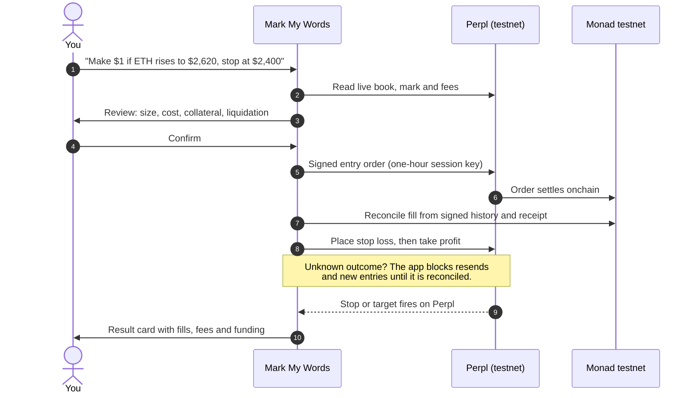
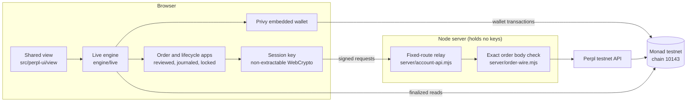

<div align="center">

<picture>
  <source media="(prefers-color-scheme: dark)" srcset="brand/mark-my-words-logo-night.svg">
  
</picture>

### Say the trade. Place the trade.

Write what you think the market will do in one sentence.<br>
Mark My Words opens it as a real perp on **Monad testnet**, with the stop loss already placed.

[](https://testnet.monadexplorer.com)
[](https://testnet.perpl.xyz)
[](https://privy.io)
[](https://react.dev)
[](tsconfig.json)
[](LICENSE)

[Try it](#try-it) · [How it works](#how-a-sentence-becomes-a-trade) · [Onchain proof](#onchain-proof) · [Run locally](#run-it-locally) · [Architecture](#architecture) · [Roadmap](#roadmap)

<br>


<sub>A real ETH long on Monad testnet, opened by a brand-new email user. The take profit and stop are live orders on Perpl.</sub>

</div>

> **I want to make $1 if ETH rises to $2,620, stop at $2,400.**
>
> You type that, and Mark My Words sizes the position from the live Perpl order book, shows the cost, collateral and liquidation price, then opens it. The stop loss and take profit go on Perpl as real orders right after the fill.

## Who it's for

Our first users are people who already post price calls but have never opened a perp. They write "ETH to 2,620 this week" in a group chat, then a perps terminal asks them for size, margin mode and trigger types before they can say what they mean. Here every blank in the sentence is an editable chip, every number on screen comes from Perpl or the chain, and you can't open a position without a stop.

Perps venues build pro terminals that start from size and leverage, and the simplified apps we've seen tend to hide the risk. We start from the trader's view and make the stop mandatory. That needs fast, cheap settlement: the app sizes the trade across live book depth, waits for the fill, then places both exits before it shows success. With Monad's 400 ms blocks and 800 ms finality, the stop and target are on the book a few seconds after the fill.

So far on testnet we've run about 40 real Perpl actions across 2 accounts. That includes a brand-new email user going from login to a closed trade alone, ETH and BTC in both directions, opens at 12x and 15x, and a take profit and a stop loss that Perpl fired on its own. Selected transactions are listed under [Onchain proof](#onchain-proof).

**Go-to-market.** Sharing a trade is how new users find the app. A user writes a call, places it with its stop, and shares a "Call your shot" card that links back to the app. We'll seed a public testnet beta through Monad community channels with a hand-picked first cohort and watch each first trade to find where people get stuck. Perpl supplies the order book and liquidity. We handle onboarding: email login, the embedded wallet and one-sentence orders.

## What works on testnet

> [!IMPORTANT]
> The default route `/` runs against **Monad testnet (chain 10143)** and **Perpl's testnet exchange**. Selected transactions are listed under [Onchain proof](#onchain-proof).

| Feature | What you do | What happens |
|---|---|---|
| Sentence trading | Set profit goal, market, direction, target and stop in one line | The app sizes it across live Perpl book levels and shows fees, collateral and liquidation before you confirm |
| Login | Sign in with email through Privy | Privy creates an embedded wallet on first login. You don't need an extension or seed phrase |
| Funding | Claim from the faucet, approve, deposit, withdraw | Each step is a wallet transaction you review, checked against its receipt |
| One-tap session | Sign once for one hour | A trade-only Perpl API key, held by a browser key that page scripts can't read. It cannot withdraw |
| Markets | Trade ETH or BTC, long or short | Two positions can be open at once, from 1x up to Perpl's maximum (ETH 12x, BTC 15x) |
| Protection | Set a stop on every entry | Stop and take profit go on Perpl as trigger orders right after the fill |
| Management | Drag a chip, close part, close all | Exits are amended in place, closes are reduce-only, and results come from Perpl's signed history |
| Honest numbers | Read what's on screen | A sent order shows as filled only after the fill is confirmed. A value the app can't verify shows as unavailable, never as 0 |

`/?mode=demo` runs a separate demo of the same interface on fixture data. It never touches a chain.

## How a sentence becomes a trade



## Onchain proof

Everything here is on testnet. Explorer: [testnet.monadexplorer.com](https://testnet.monadexplorer.com).

We use Perpl's and Monad's existing contracts and deployed none of our own:

| Contract | Address |
|---|---|
| Perpl exchange | [`0x1964C32f0bE608E7D29302AFF5E61268E72080cc`](https://testnet.monadexplorer.com/address/0x1964C32f0bE608E7D29302AFF5E61268E72080cc) |
| AUSD collateral | [`0xa9012a055bd4e0eDfF8Ce09f960291C09D5322dC`](https://testnet.monadexplorer.com/address/0xa9012a055bd4e0eDfF8Ce09f960291C09D5322dC) |
| Test AUSD faucet | [`0xd236c18D274E54FAccC3dd9DDA4b27965a73ee6C`](https://testnet.monadexplorer.com/address/0xd236c18D274E54FAccC3dd9DDA4b27965a73ee6C) |

Selected transactions from a fresh email user's account, Oct 12 to 13, 2026:

| Step | Market | Transaction |
|---|---|---|
| Claim test AUSD | wallet | [`0xe3ec…70f3`](https://testnet.monadexplorer.com/tx/0xe3eca08b1a3bad2b83e3a699ea9344a361a159acfe3875d288c903ef218870f3) |
| Create Perpl account and deposit 100 AUSD | account 1168 | [`0x3b7d…37e8`](https://testnet.monadexplorer.com/tx/0x3b7df65f0c11652431070d26c36e8588d2fe465b7c5be5f49455a00bca4c37e8) |
| Open long from a sentence, 3x | ETH | [`0x514f…41e1`](https://testnet.monadexplorer.com/tx/0x514f6e4f91ca74598d05e1b1c8f76b9765dda67b4cf0b14ff0704cb9835241e1) |
| Full reduce-only close | ETH | [`0x8286…97bf`](https://testnet.monadexplorer.com/tx/0x828675f1d539083ddae200c95fd4e96ae50bcd96876ceed75642bf79c0f497bf) |
| Partial close 50% | ETH | [`0x067b…cabf`](https://testnet.monadexplorer.com/tx/0x067b217cae0ae7f33b04fe4aeccc9a4d54749c7255ab38106906254567e4cabf) |
| Open short | ETH | [`0x354a…3f30`](https://testnet.monadexplorer.com/tx/0x354ad06757d2eba0594c4f17e586121152c37bf94778bd602eea24df783e3f30) |
| Open short | BTC | [`0xb64d…efd5`](https://testnet.monadexplorer.com/tx/0xb64d9b08949579ebeefef4d20d5a6863ccf71a79e4cb42a0609434a3c82cefd5) |
| Take profit fired by Perpl, no close sent by the app | BTC | [`0x4160…70f8`](https://testnet.monadexplorer.com/tx/0x4160a91fb48e68e2c8a7ef5ba40c7a783f06d794c2c671077ea98377742570f8) |
| Stop loss fired by Perpl, no close sent by the app | ETH | [`0x7951…3521`](https://testnet.monadexplorer.com/tx/0x79510336c475e835ff57903e2efb9080d8a96ddac1df3781ba44672ce1d43521) |
| Open long at 15x, Perpl's maximum | BTC | [`0x772a…01a9`](https://testnet.monadexplorer.com/tx/0x772afa0253bde86f58214e81e72c0e471b711acaae0bad1f5f0d3833b78401a9) |

> [!NOTE]
> We set both triggers just past the market price so they would fire immediately, so these fills don't come from natural price moves. They show that Perpl executes the exit and the app picks it up without sending a close.

<div align="center">

<br><sub>Perpl fired the take profit. The app found the fill in signed history and showed the result.</sub>
</div>

## Try it

<!-- TODO: replace with the deployed Render URL before submission -->
**Live app:** _deployment link coming_

Nothing to install. You need an email address and about two minutes to fund the account.

1. **Log in** with any email. Privy creates a wallet for you, and its address is in the account sheet.
2. **Get gas.** Send a little testnet MON to that address from [faucet.monad.xyz](https://faucet.monad.xyz). Every funding step is a wallet transaction, and none spends more than 0.05 MON.
3. **Get collateral.** Open the balance pill and choose Add funds. Claim test AUSD from the faucet, approve it, then deposit. A new Perpl account needs at least 100 AUSD, and the deposit creates the account. Then allow order forwarding when the app asks.
4. **Turn on one-tap trading** in the account sheet. It takes one signature and lasts an hour.
5. **Trade.** Write your sentence, press Review, tick the box and open the position. Watch the stop and target register, drag either chip to move it, or press Close to close part or all of it.

> [!TIP]
> For a tour without a wallet, open `/?mode=demo`.

## Run it locally

<details>
<summary>Only needed to build from source. Judges can use the live app above.</summary>

<br>

You need Node 22.12 or newer.

```bash
npm ci
cp .env.example .env.local
npm run build
PERPL_APP_ORIGIN=http://localhost:3000 PORT=3000 npm start
```

Open http://localhost:3000. `.env.example` holds only a public Privy app ID, and its allowed origin is `http://localhost:3000`, so use that exact origin and port.

| Command | What it does |
|---|---|
| `npm run live` | Rebuilds on change and serves http://localhost:3000 |
| `npm run check` | TypeScript and formatting |
| `npm test` | Money math, long and short order encoding, duplicate-send and unknown-outcome prevention, main journeys |
| `npm run build` | Production build into `dist/` |

</details>

## Architecture



| Area | Files |
|---|---|
| Exact money math in scaled integers | `src/financial-model.ts`, `src/perpl-sizing.ts`, `src/perpl-trade-review.ts` |
| Orders, journal and reconciliation | `src/order-application.ts`, `src/order-journal.ts`, `src/lifecycle-application.ts` |
| Exits, fills, fees and results | `src/perpl-lifecycle.ts`, `src/perpl-order-history.ts`, `src/perpl-lifecycle-settlement.ts` |
| One wallet lock across tabs | `src/account-coordination.ts` |
| Testnet trading policy | `src/testnet-limits.ts` |
| Relay and order validation | `server/account-api.mjs`, `server/order-wire.mjs` |

### Safety rules the code enforces

- An acknowledgment is not a fill.
- An unknown outcome blocks a resend and any new entry on that account until it is reconciled.
- One wallet lock is shared across tabs, so two tabs can't send the same order twice.
- Money stays in scaled integers and native units below React.
- A missing value shows as unavailable, never as 0.
- A reduce-only close is always reachable.

## Testnet limits

These limits are deliberate. They live in [`src/testnet-limits.ts`](src/testnet-limits.ts), and no env variable, URL or storage setting can override them.

- Testnet only, ETH and BTC only, one position per market.
- Your free collateral sets the maximum size. Leverage runs from 1x to Perpl's maximum (ETH 12x, BTC 15x) and defaults to 3x.
- Every entry needs a stop loss. A wallet transaction can spend at most 0.05 MON on gas.
- Stops and targets are Perpl trigger orders, and a trigger doesn't guarantee the fill price.
- Perpl allows 16 API keys per profile and counts expired ones. Heavy testers may need to revoke old keys at [testnet.perpl.xyz/apikeys](https://testnet.perpl.xyz/apikeys).

> [!WARNING]
> Without an active one-hour session the app still shows open positions from the chain, but you need to turn the session on again to manage them.

## Roadmap

I'm a solo builder and new to Monad. Items marked *(Perpl)* depend on Perpl's API, listings or approval.

### Phase 1: Public testnet beta (Q4 2026)

| Deliverable | Success metric |
|---|---|
| Public testnet deployment | Live URL, and 50 wallets complete a full journey from open to close |
| Interviews with first-time perp traders | 15 sessions, with the top 3 friction points fixed and published |
| Open-source the Perpl TypeScript client and order-safety layer: acknowledgment vs fill, unknown-outcome lock, duplicate-send guard | Published with docs and tests, and 1 outside project using or forking it |
| Weekly public build log | 12 weekly updates in a row |
| Written integration feedback to Perpl and Privy | 2 reports covering API-key limits, session UX and docs gaps |

### Phase 2: Audit and hardening (Q1 to Q2 2027)

| Deliverable | Success metric |
|---|---|
| Add to or reduce a position, add collateral *(Perpl)* | 0 unreconciled outcomes across 500+ testnet orders |
| Longer sessions that don't use up Perpl API keys *(Perpl)* | At most 1 API key per user per day |
| Mobile-first layout | Full journey works on a 375 px screen |
| Conditional sentences such as "If ETH drops to $2,300, go long", placed as resting orders on Perpl so no key has to sign while you're away | Same review and stop rules as market entries |
| Scoped security audit of the money math, session-key signing, order relay and duplicate-send prevention | Report published, all high and critical issues fixed |
| Monitoring for orders with an unknown outcome | Alert within 60 s, runbook published |

> [!IMPORTANT]
> **No mainnet before the audit.** We have no custom contracts, so the audit covers the code that carries the user's intent and signing authority: the client, the session keys and the relay.

### Phase 3: Staged mainnet and growth (Q3 to Q4 2027)

| Deliverable | Success metric |
|---|---|
| Geo-restriction and terms reviewed by counsel, following Perpl's access policy | In place before any mainnet order |
| Staged mainnet: an allowlist with per-user size caps, then higher caps, then open access *(Perpl)* | 100 allowlisted traders and 0 lost-funds incidents at each stage |
| Public bug bounty | Live from mainnet launch |
| "Call your shot" share cards: post the sentence before the trade, and the result card can be checked onchain | 20% of closed trades shared |
| Card or bank onramp through Privy | Under 5 minutes from signup to first trade |
| Trading volume | $1M cumulative notional in the first 90 days of open mainnet |

Perpl runs the order book, so our job is to bring traders. We'll consider other Monad perps venues once the product has found its market.

We'll ask Perpl whether a builder or referral fee is available before we pick a revenue model. After Phase 1 we plan to apply to Monad's accelerator and grant programs to pay for the audit and the move to mainnet.

### What we need from Monad

- An introduction to a security reviewer, and a grant or subsidy toward the audit.
- Help with Perpl mainnet API access, origin approval and a higher API-key allowance.
- Enough testnet MON and AUSD from the faucets to onboard beta testers.
- A spot in an ecosystem newsletter or demo day once the public testnet is live.
- A direct line to the Perpl and Privy teams for integration feedback.

### Why we'll keep building

Mark My Words already places real orders on Monad testnet with required stops, take profits and reconciled results, and a first-time user has completed the whole journey alone. The hardest work was the execution layer around Perpl that handles unknown outcomes and duplicate sends. That part is built, and we'll open-source it so other Monad builders can reuse it. We don't have outside users or partners yet. Next we put the app in front of real traders, publish progress every week so you can check us against this roadmap, and launch on mainnet only after we hit the numbers above.

## Hackathon

Built for Monad Metropolis (October 2026). Primary track: Onchain Finance & Trading. Bounties: Privy and Best use of Perpl's API.

- Monad: every trade, deposit and exit settles on Monad testnet, and the app reads it back from finalized blocks.
- Privy: email login creates the embedded wallet, which signs every funding transaction and the one-hour trading session.
- Perpl: the live book, candles, signed history, entries, trigger exits, amendments and reduce-only closes all go through Perpl's API.

## Built with

[React 19](https://react.dev) · [Vite](https://vite.dev) · [viem](https://viem.sh) · [Privy](https://privy.io) · [Radix UI](https://www.radix-ui.com) · [Perpl](https://perpl.xyz) · [Monad](https://monad.xyz) · Inter Tight and JetBrains Mono via Fontsource

AI disclosure: the interface design was iterated in Claude, and the code was written with help from Claude Code and OpenAI Codex. Every testnet action was run and checked in the real app.

<div align="center">
<br>

<br>
<sub>Mark My Words · testnet only · not financial advice</sub>
</div>
